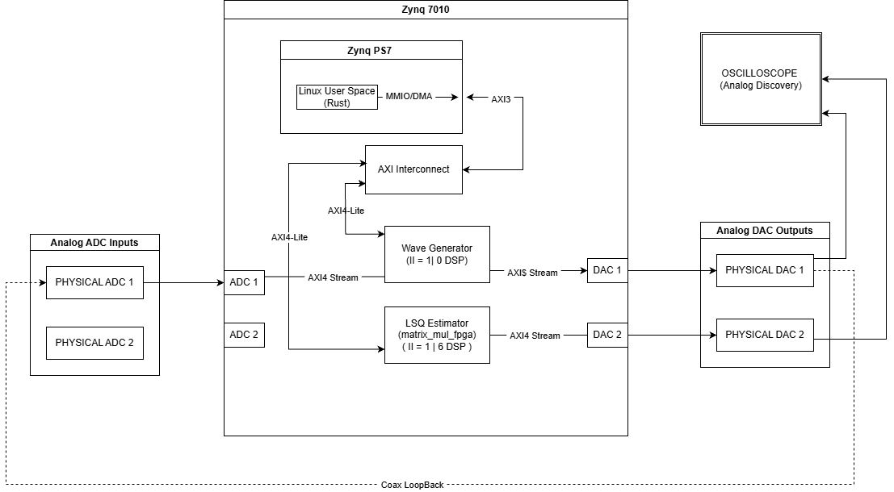
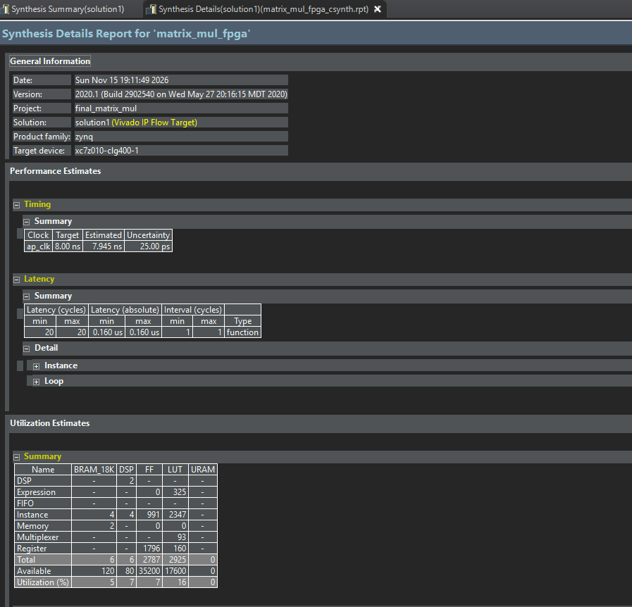
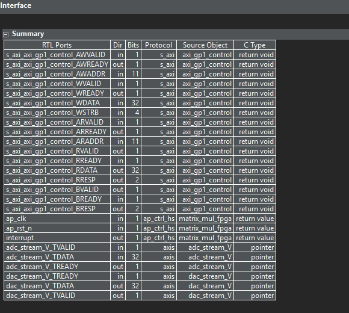
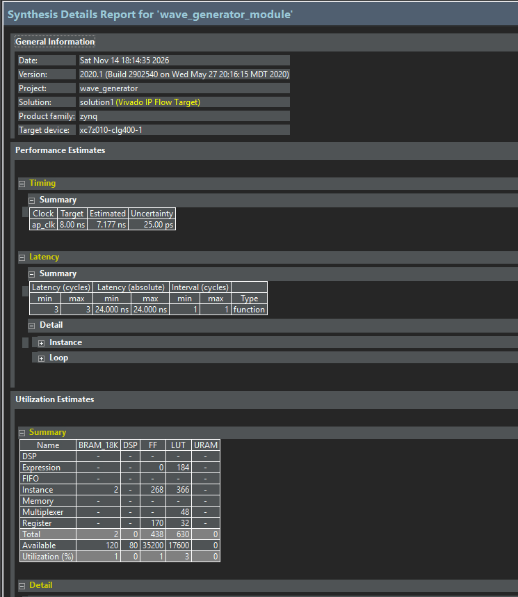
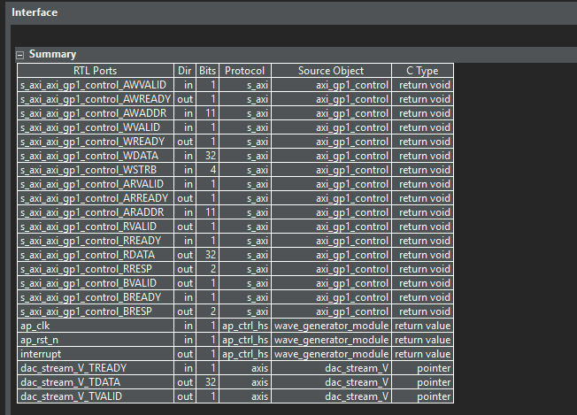
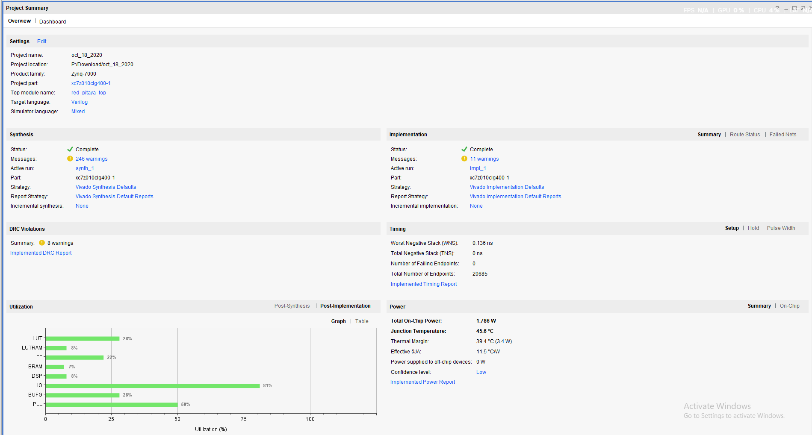
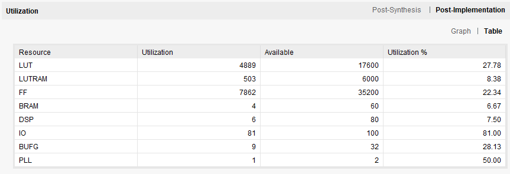
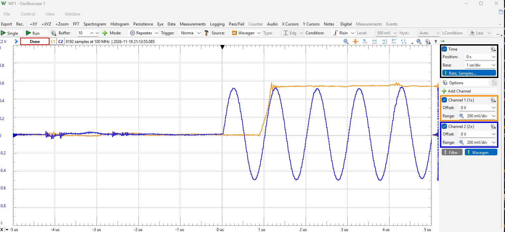
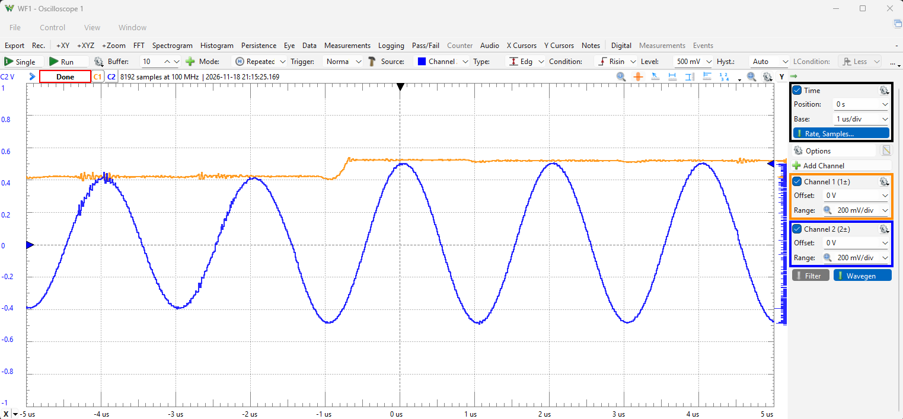
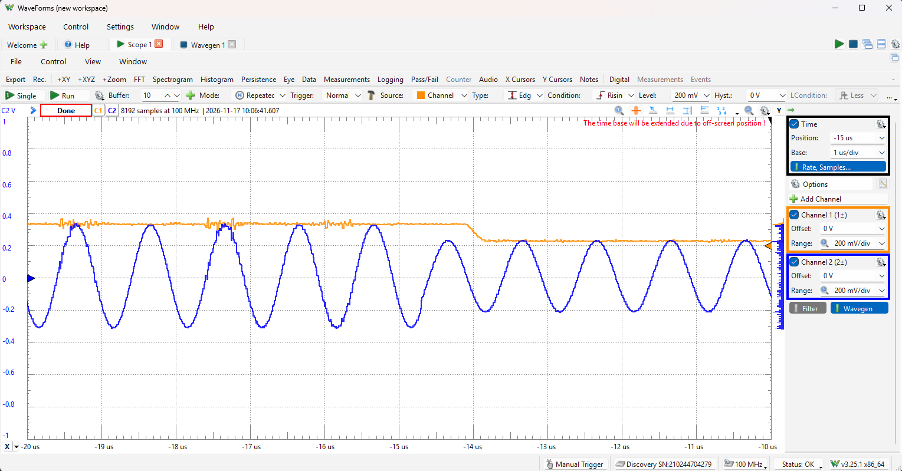

# Sub-Cycle Real-Time RF Least Squares Estimator on Zynq-7010 (`125 MSPS` | `500 kHz – 2 MHz`)

A deterministic, single-cycle-throughput (`II = 1`) hardware Least Squares (LSE) RF amplitude estimator and custom stimulus generator implemented on a **Red Pitaya STEMlab 125-14 (`xc7z010clg400-1`)**, supervised by an event-driven **Linux user-space Rust** control plane over MMIO.

> **Proprietary Notice:** All RTL, Vitis HLS C++ kernels, and Rust driver source files are closed-source. This repository documents the verified system architecture, synthesis/timing closure metrics, and physical oscilloscope benchmarks.

---

## Key Performance & Timing Benchmarks

| Metric | Measured Result | Engineering Significance |
| :--- | :--- | :--- |
| **Operating Carrier Range** | `500 kHz – 2 MHz` | Verified across both internal `DAC1` coax loopback and external RF signal generators (`62.5 – 250` samples/cycle at `125 MSPS`). |
| **Sample Rate & Pipeline Throughput** | `125 MSPS` (`II = 1`) | Zero-stall, single-cycle initiation interval across both HLS cores (`8.00 ns` clock period). |
| **HLS Core Compute Latency** | `160 ns` (`20` cycles) | Deterministic fixed-latency matrix projection inside `lsq_estimator` (`matrix_mul_fpga`). |
| **End-to-End Analog Lock-In** |`~500 ns` lock / `~1.2 µs` total for `1 MHz` | `~500 ns` (`0.5` RF cycles) estimator step lock-in (`~1.2 µs` total `ADC1`-to-`DAC2` analog path) with `< 0.5`-cycle symmetric step-up and step-down tracking. |
| **Post-Implementation Timing** | `WNS +0.135 ns` (`125 MHz`) | `0 ns` TNS, **`0` failing endpoints out of `20,685`**, **`0` DRC errors**, and **`0` critical warnings**. |
| **Silicon Footprint & Power** | `28%` LUT / `7.5%` DSP | `1.786 W` total on-chip power (`45.6 °C` junction temp, `39.4 °C` thermal margin) with over `70%` LUT headroom free. |

---

## System Architecture

### Architectural Overview
* **High-Speed Data Plane (`125 MHz` AXI4-Stream):** Raw `14-bit` RF samples captured from `PHYSICAL ADC 1` stream continuously via `AXI4-Stream` into the `lsq_estimator` (`matrix_mul_fpga`) IP core (`II = 1`, `6` DSP48E1 slices) and emit real-time amplitude estimates out through `PHYSICAL DAC 2`.
* **Built-In Stimulus Generator (`0` DSPs):** A parallel, zero-DSP `wave_generator` core (`II = 1`, `3`-cycle / `24 ns` latency) drives `PHYSICAL DAC 1` to provide a self-contained closed-loop coax test signal alongside support for independent external RF signal generators.
* **Event-Driven Control & Supervision ( Rust on ARM Cortex-A9):** A Linux user-space Rust supervisor running on the Zynq PS7 configures basis weights and waveform parameters via `MMIO/DMA` (`AXI3` → `AXI Interconnect` → `AXI4-Lite`).
* **Continuous Line-Rate Validation (`Zero Control-Plane Overhead`):** Once configured, the `125 MSPS` (`II = 1`) `AXI4-Stream` datapath runs autonomously in programmable logic—continuously validating and tracking incoming RF envelopes with **zero per-sample ARM CPU intervention or AXI control-bus overhead**.

---

## Vitis HLS Synthesis Verification (`xc7z010clg400-1`)

### Least Squares Core (`matrix_mul_fpga`)
* **Timing & Throughput:** `7.945 ns` estimated clock vs. `8.00 ns` target (`125 MHz`), `20`-cycle (`160 ns`) latency, **`II = 1` (`125 MSPS`)**.
* **Resource Footprint:** **`6 / 80` DSPs (`7%`)**, `6 / 120` BRAMs (`5%`), `2,787` FFs (`7%`), and `2,925` LUTs (`16%`).
* **AXI Interfaces:** `s_axi_axi_gp1_control` (11-bit address / 32-bit data) + 32-bit `adc_stream_V` and `dac_stream_V` AXI4-Stream ports.

### Fractional Multi-Waveform Synthesizer (`wave_generator_module`)
* **Timing & Throughput:** `7.177 ns` estimated clock vs. `8.00 ns` target (`125 MHz`), `3`-cycle (`24.000 ns`) latency, **`II = 1` (`125 MSPS`)**.
* **Resource Footprint:** **`0 / 80` DSPs (`0%`)**, `2 / 120` BRAMs (`1%`), `438` FFs (`1%`), and `630` LUTs (`3%`).
* **AXI Interfaces:** `s_axi_axi_gp1_control` (11-bit address / 32-bit data) + 32-bit `dac_stream_V` AXI4-Stream port.

---

## Vivado Top-Level Post-Implementation Verification (`red_pitaya_top`)

Full place-and-route results with both IP cores, AXI interconnects, and Red Pitaya ADC/DAC wrappers integrated onto the Zynq-7010 (`xc7z010clg400-1`):

* **Timing Closure (`125 MHz`):** **`+0.136 ns` Worst Negative Slack (WNS)**, `0 ns` Total Negative Slack, and **`0` failing endpoints** out of **`20,685`** total paths.
* **Post-Implementation Utilization:** **`6 / 80` DSP48E1 (`7.50%`)**, `4 / 60` BRAMs (`6.67%`), `4,889` LUTs (`27.78%`), `503` LUTRAM (`8.38%`), and `7,862` FFs (`22.34%`).
* **Thermal & Power:** **`1.786 W`** total on-chip power (`45.8 °C` junction temperature, `39.4 °C` thermal margin).

## Full SoC Post-Implementation Summary (`red_pitaya_top`)

| Resource | Used | Available | Utilization |
| :--- | :---: | :---: | :---: |
| **LUT** | `4,889` | `17,600` | **`27.78%`** |
| **LUTRAM** | `503` | `6,000` | **`8.38%`** |
| **FF (Flip-Flops)** | `7,862` | `35,200` | **`22.34%`** |
| **BRAM (`36Kb` eq.)** | `4` | `60` | **`6.67%`** |
| **DSP48E1** | `6` | `80` | **`7.50%`** |
| **IO** | `81` | `100` | **`81.00%`** |
| **BUFG** | `9` | `32` | **`28.13%`** |
| **PLL** | `1` | `2` | **`50.00%`** |

---

## Physical Oscilloscope Verification (`WaveForms` / Analog Discovery)

All transient and steady-state measurements were captured directly from the Red Pitaya analog outputs (`Channel 1` Orange = `DAC2` LSE Amplitude Estimate; `Channel 2` Blue = `DAC1` / External RF Input Reference).

### 1. Cold-Start Step Lock-In (`~500 ns` at `1 MHz`)

* From an idle zero state, the estimator locks onto the `~500 mV` peak amplitude within **`~500 ns`** (`0.5` RF cycles), holding a flat steady-state estimate with zero overshoot.

### 2. Dynamic Amplitude Step-Up (`~400 mV` → `~500 mV`)

* Upon an instantaneous input amplitude step, the `125 MSPS` (`II = 1`) sliding pipeline tracks the new peak envelope inside **`< 0.5` RF cycles** with zero sample drops or pipeline stalls.

### 3. Dynamic Amplitude Step-Down (`~350 mV` → `~200 mV` at `1 Mhz`)

* Unlike traditional diode or peak-hold envelope detectors that suffer from slow RC decay, the Least Squares projection drops cleanly onto the lower amplitude in **`< 0.5` RF cycles** with zero undershoot.

> **Live Demonstration:** End-to-end hardware demonstration video (Vitis HLS synthesis → Vivado bitstream generation → SSH Zynq flashing → Rust bring-up → live oscilloscope step tracking) available upon request.

---
## Contact & Collaboration
Open to **FPGA Design, Real-Time RF/DSP, and Embedded Rust/Linux** engineering roles or technical collaborations.  
📧 **Email:** `pramodsb884@gmail.com`
